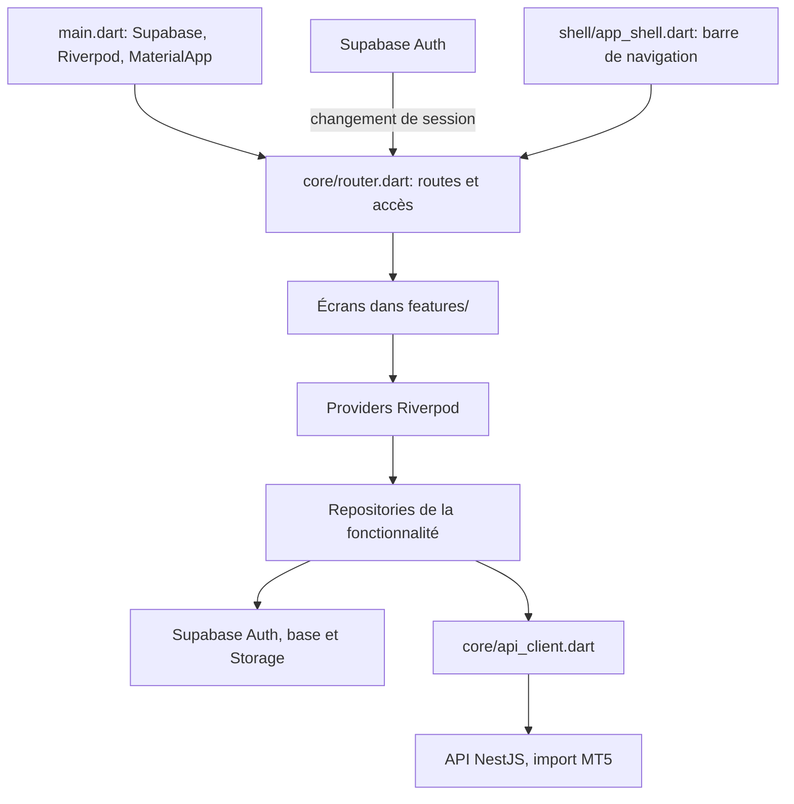

# Guide de développement

Ce guide décrit l'architecture actuellement présente dans le dépôt. L'application utilise une architecture légère organisée par fonctionnalité ; elle n'a pas encore de couche `domain` ou de cas d'utilisation séparés.

## Créer un projet Supabase de zéro

### 1. Créer le projet

1. Connecte-toi à [Supabase](https://supabase.com/dashboard) et crée une organisation si nécessaire.
2. Choisis **New project**, sélectionne l'organisation, puis donne un nom au projet, par exemple `trade-track-dev`.
3. Crée un mot de passe de base de données fort et conserve-le dans un gestionnaire de mots de passe. Ce mot de passe n'est pas la clé utilisée par Flutter ; ne le mets pas dans le code ni dans `--dart-define`.
4. Choisis une région proche des utilisateurs ou du serveur de l'application, puis crée le projet. Attends que son statut indique qu'il est prêt.

### 2. Initialiser les tables et le stockage

Dans le projet, ouvre **SQL Editor**, crée une nouvelle requête et exécute le contenu de chacun de ces fichiers, un par un et dans cet ordre :

1. `supabase/migrations/001_init.sql` : tables profils, comptes, trades, tags et politiques RLS.
2. `supabase/migrations/002_import_jobs.sql` : suivi des imports.
3. `supabase/migrations/003_storage_imports.sql` : bucket privé `imports` et règles d'accès utilisateur.
4. `supabase/migrations/004_profile_trigger.sql` : création automatique du profil à l'inscription.

Exécute le contenu complet de chaque fichier dans sa propre requête. Vérifie que le SQL Editor termine chaque exécution sans erreur. Ensuite, dans **Table Editor**, les tables principales (`profiles`, `accounts`, `trades`, `tags`, `trade_tags`, `import_jobs`) doivent apparaître ; dans **Storage**, le bucket `imports` doit être privé.

### 3. Activer l'inscription par email

Dans **Authentication > Sign In / Providers**, vérifie que le fournisseur Email et l'inscription sont activés. Pour un premier essai, tu peux désactiver temporairement la confirmation d'adresse dans les réglages d'authentification afin de vérifier le flux sans dépendre de l'envoi d'emails. Pour un vrai déploiement, garde la confirmation activée et configure un serveur SMTP adapté ; ne considère pas l'envoi de test par défaut comme un service de production.

Si la confirmation est activée, l'inscription peut être acceptée sans que l'application reçoive immédiatement une session : il faut ouvrir le lien reçu par email. Le trigger de la migration `004_profile_trigger.sql` crée alors (ou lors de l'inscription) le profil lié à l'utilisateur.

### 4. Récupérer les valeurs client

Dans **Project Settings > API** ou **Connect**, copie les valeurs de ce projet :

- **Project URL** vers `SUPABASE_URL`, sous la forme `https://<project-ref>.supabase.co`.
- **Publishable key** (ou clé `anon` des anciens projets) vers `SUPABASE_ANON_KEY`.

Ne rajoute aucun chemin (`/auth/v1`, `/rest/v1`) à l'URL. N'utilise jamais `service_role` comme clé Flutter. Ne partage pas la clé ou le mot de passe de base de données dans un message ou une capture.

### 5. Lancer l'application et vérifier

Depuis la racine du dépôt, dans PowerShell, remplace les deux valeurs par celles copiées à l'étape précédente :

```powershell
flutter pub get
flutter run -d edge --web-port=5000 --dart-define=SUPABASE_URL=https://<project-ref>.supabase.co --dart-define=SUPABASE_ANON_KEY=<publishable-key>
```

Sur l'écran de connexion, crée un compte email de test. Vérifie dans **Authentication > Users** qu'il apparaît. Après validation de l'email si elle est activée, vérifie dans **Table Editor > profiles** que le profil a été créé. Vérifie également que la navigation quitte `/login` après ouverture de session.

Pour confirmer que l'URL et la clé atteignent le service Auth, tu peux lancer dans une autre fenêtre PowerShell :

```powershell
$headers = @{ apikey = '<publishable-key>' }
Invoke-WebRequest -UseBasicParsing -Uri 'https://<project-ref>.supabase.co/auth/v1/health' -Headers $headers
```

Une réponse `200` valide seulement l'accès au service Auth, pas encore l'inscription elle-même. Si l'inscription échoue avec `404`, confirme que l'URL et la clé viennent du même projet et inspecte l'onglet Réseau d'Edge : l'appel doit viser `/auth/v1/signup`. Ce flux n'utilise pas `API_BASE_URL`.

### 6. Ajouter Google et Apple (facultatif)

Commence par faire fonctionner l'inscription email. Les boutons OAuth ne fonctionneront qu'après la configuration des fournisseurs :

1. Dans **Authentication > URL Configuration**, définis le **Site URL** pour le Web et autorise `http://localhost:5000/**`. Ajoute aussi les URL de développement et de production réellement utilisées.
2. Autorise `io.supabase.tradetrack://login-callback` pour les retours sur mobile. Ce schéma est déjà déclaré dans la configuration Android et iOS du dépôt.
3. Dans **Authentication > Sign In / Providers**, active Google et/ou Apple et entre les identifiants créés dans les consoles de ces fournisseurs.
4. Dans la console Google ou Apple, inscris comme callback OAuth Supabase `https://<project-ref>.supabase.co/auth/v1/callback`.
5. Pour Apple, prépare les valeurs de compte développeur demandées par Supabase (Services ID, Team ID, Key ID et clé privée). La création de ces identifiants se fait dans le compte développeur Apple, pas dans Flutter.

Les identifiants fournis par Google/Apple sont différents de la clé publishable Supabase. Conserve les secrets OAuth dans le tableau de bord Supabase et les consoles fournisseurs, jamais dans l'application Flutter.

## Démarrer l'application

Prérequis : Flutter/Dart compatibles avec les versions indiquées dans `pubspec.yaml`, et un projet Supabase.

```powershell
flutter pub get
flutter run --dart-define=SUPABASE_URL=https://<project-ref>.supabase.co --dart-define=SUPABASE_ANON_KEY=<publishable-key>
```

Les deux valeurs doivent appartenir au même projet Supabase. L'URL est la racine du projet, sans `/auth/v1`, `/rest/v1` ni slash final. Utilise la clé publishable/anon, jamais la clé `service_role` dans l'application.

L'API NestJS n'est nécessaire que pour l'import MT5. Pour l'émulateur Android, configure `API_BASE_URL` avec l'adresse de l'hôte vue depuis l'émulateur, généralement `http://10.0.2.2:3000`. Un simulateur iOS utilise généralement `http://localhost:3000`. En production, utilise HTTPS.

## Architecture actuelle



| Emplacement | Responsabilité |
| --- | --- |
| `lib/main.dart` | Initialisation Supabase, `ProviderScope` et `MaterialApp.router`. |
| `lib/core/` | Routeur, thème, réglages, traductions et client HTTP commun. |
| `lib/features/<fonction>/` | Écrans, modèles et logique propres à une fonctionnalité. |
| `lib/shell/` | Structure commune des pages avec navigation principale. |
| `supabase/migrations/` | Évolutions du schéma, fonctions, stockage et politiques RLS. |
| `test/` | Tests Flutter des calculs et des widgets. |

Les écrans présentent l'interface et déclenchent les actions. Quand une action lit ou modifie les données, le repository de la fonctionnalité regroupe l'accès à Supabase ou à l'API ; Riverpod fournit ce repository et expose les états asynchrones. Le code est encore un MVP : certaines petites actions restent directement dans les écrans. Pour une nouvelle fonctionnalité, suis d'abord le modèle déjà utilisé dans cette fonctionnalité et évite de déplacer du code sans nécessité.

## Navigation entre les pages

Les routes sont déclarées dans `lib/core/router.dart`. La session Supabase y protège les routes : sans session, l'utilisateur est dirigé vers `/login`; après connexion, il revient dans l'application. `ShellRoute` entoure les pages principales avec `AppShell`.

| Route | Page | Navigation |
| --- | --- | --- |
| `/` | Accueil | Onglet principal |
| `/journal` | Journal | Onglet principal |
| `/analytics` | Analytics | Onglet principal |
| `/risk` | Risque | Onglet principal |
| `/markets`, `/community`, `/profile` | Pages provisoires | Onglets principaux |
| `/journal/new` | Création d'un trade | Page secondaire, sans barre d'onglets |
| `/import` | Import MT5 | Page secondaire, sans barre d'onglets |
| `/login` | Connexion/inscription | Page publique |

Dans un widget avec `BuildContext`, utilise `context.go('/journal')` pour remplacer la destination courante, `context.push('/journal/new')` pour ouvrir une page secondaire avec retour possible, et `context.pop()` pour revenir. Utilise les chemins déclarés dans le routeur ; ne duplique pas la navigation avec des `Navigator.push` pour les pages de l'application.

### Ajouter une page

1. Crée l'écran dans `lib/features/<fonction>/`, en réutilisant le dossier existant si la page lui appartient.
2. Si la page utilise des données, ajoute ou étends le modèle et le repository de cette fonctionnalité, puis expose-le avec un provider Riverpod.
3. Déclare son chemin et son builder dans `lib/core/router.dart`.
4. Si la page est un onglet principal, ajoute également son entrée dans la liste `_tabs` de `lib/shell/app_shell.dart` et ses libellés FR/EN dans `lib/core/strings.dart`. Une page secondaire n'a pas besoin d'un onglet.
5. Ouvre la page avec `context.go` ou `context.push` selon qu'elle remplace la destination ou qu'elle doit pouvoir être quittée par retour.
6. Ajoute ou mets à jour un test ciblé dans `test/`, puis lance `flutter analyze` et `flutter test`.

## Données et évolutions Supabase

- Garde les accès réseau et base de données dans le repository concerné plutôt que de les disperser dans les widgets.
- La sécurité des lignes dépend des politiques RLS Supabase : toute nouvelle table ou règle doit être conçue et testée côté Supabase, pas seulement masquée dans l'interface.
- Les fichiers `supabase/migrations/` sont numérotés et doivent être appliqués dans l'ordre. Une migration déjà appliquée ne doit pas être réécrite pour modifier une base existante : ajoute une nouvelle migration.
- L'import MT5 dépose d'abord le fichier dans Supabase Storage, puis appelle l'API NestJS par `ApiClient`. Le login et l'inscription email passent directement par Supabase Auth, pas par `API_BASE_URL`.
- Ne journalise pas de mot de passe, jeton de session ou clé privée. Les clés destinées au client ne remplacent pas les politiques RLS.

## Tests et diagnostic

Lance les contrôles depuis la racine du projet :

```powershell
flutter analyze
flutter test
```

Tests présents : `test/widget_test.dart` (widget/localisation), `test/trade_test.dart` (trades) et `test/import_test.dart` (import). Lorsqu'un test échoue, commence par le test concerné, puis élargis aux deux commandes ci-dessus après correction.

### Inscription : « received an empty response with status code 404 »

L'inscription appelle `Supabase.instance.client.auth.signUp` depuis `lib/features/auth/auth_repository.dart`. Un `404` à ce moment-là n'est pas une route de l'API MT5. Le `404` signifie que le serveur appelé n'a pas trouvé la route ; un message vide ne donne pas à lui seul la cause exacte.

1. Vérifie que le lancement fournit `SUPABASE_URL` et `SUPABASE_ANON_KEY`, qu'ils proviennent du même projet et qu'ils sont repris après chaque redémarrage. L'URL doit ressembler à `https://<project-ref>.supabase.co`, sans chemin ajouté. N'utilise pas `API_BASE_URL` pour l'authentification.
2. Dans le tableau de bord Supabase du même projet, vérifie que le projet est actif et que l'inscription email est autorisée dans **Authentication > Sign In / Providers**. Si la confirmation par email est activée, l'inscription peut réussir sans ouvrir immédiatement une session : vérifie la boîte mail.
3. Contrôle l'accessibilité de l'API Auth en remplaçant les valeurs ci-dessous. Une réponse HTTP `200` confirme que l'URL et la clé atteignent le service Auth, mais ne valide pas à elle seule une inscription :

   ```powershell
   $headers = @{ apikey = '<SUPABASE_ANON_KEY>' }
   Invoke-WebRequest -Uri 'https://<project-ref>.supabase.co/auth/v1/health' -Headers $headers
   ```

4. Si le contrôle répond `200` mais que l'inscription donne encore `404`, vérifie dans les outils réseau du navigateur ou les logs de l'application l'URL exacte demandée. Elle doit viser le projet Supabase et son endpoint `/auth/v1/signup`, pas l'API MT5 ni une URL Supabase avec un chemin erroné. Vérifie aussi qu'aucun proxy ou configuration locale ne remplace l'URL.
5. Google et Apple sont des fournisseurs séparés : active chaque fournisseur et configure ses identifiants OAuth dans Supabase. Le callback à déclarer chez le fournisseur est `https://<project-ref>.supabase.co/auth/v1/callback`. Dans **Authentication > URL Configuration**, autorise `io.supabase.tradetrack://login-callback` pour le mobile. Pour le web, configure le **Site URL** et autorise les URL de développement et de production utilisées par l'application.
6. Si le message apparaît lors de l'import MT5 après connexion, ce n'est pas le flux d'inscription : vérifie alors `API_BASE_URL`, que l'API NestJS est démarrée et que sa route `/imports` existe.

Les identifiants OAuth Google/Apple doivent être configurés dans leurs consoles respectives et dans Supabase ; le code Flutter ne peut pas les créer à ta place. Ne partage jamais de mot de passe ou de jeton pour diagnostiquer l'erreur. L'URL du projet et le code HTTP exact suffisent pour poursuivre le diagnostic.